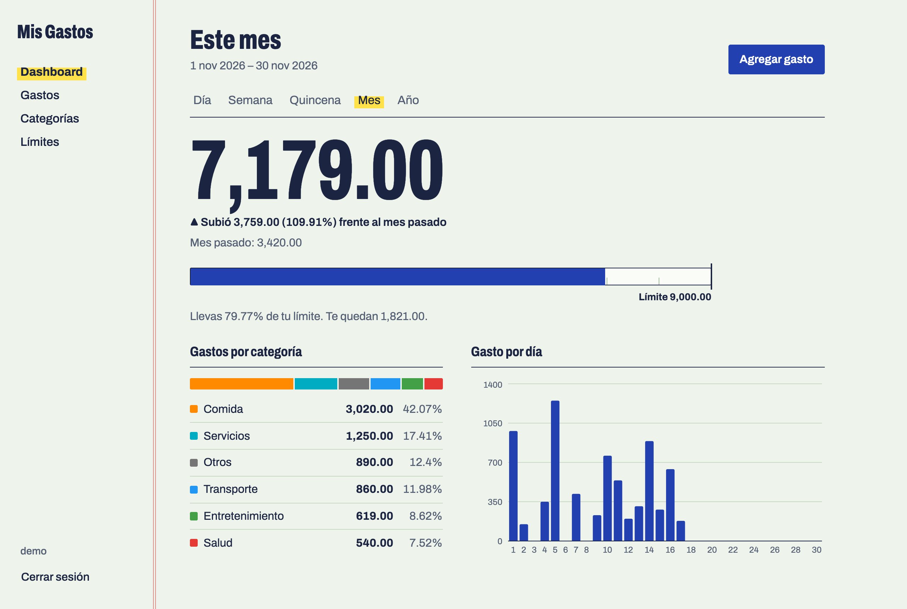
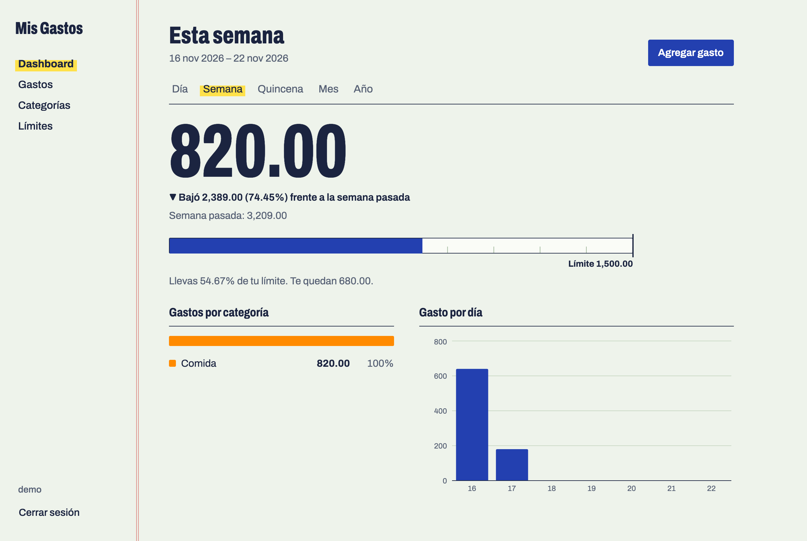
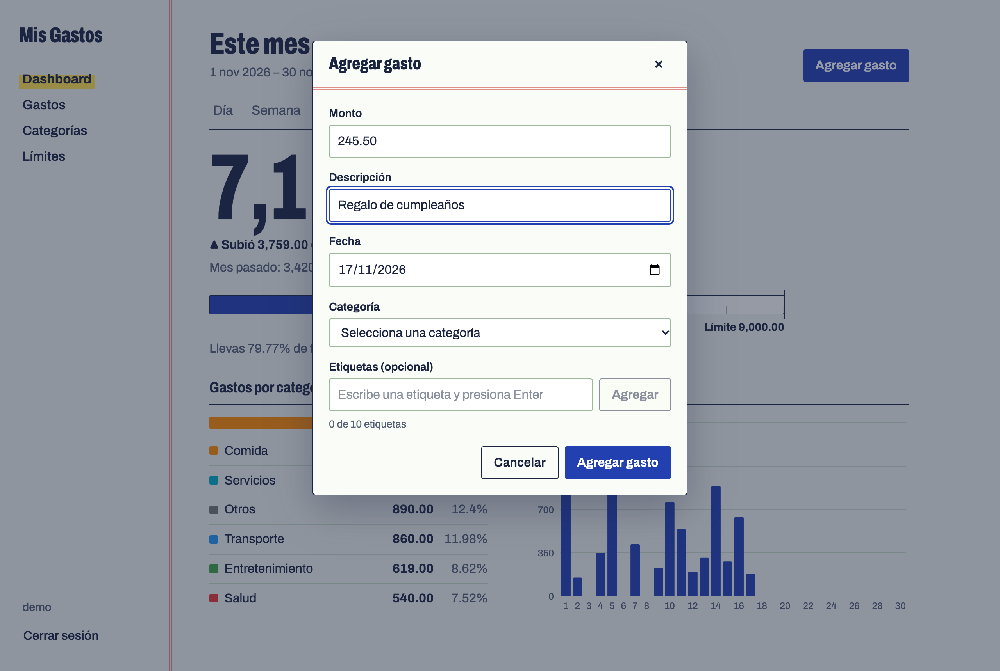
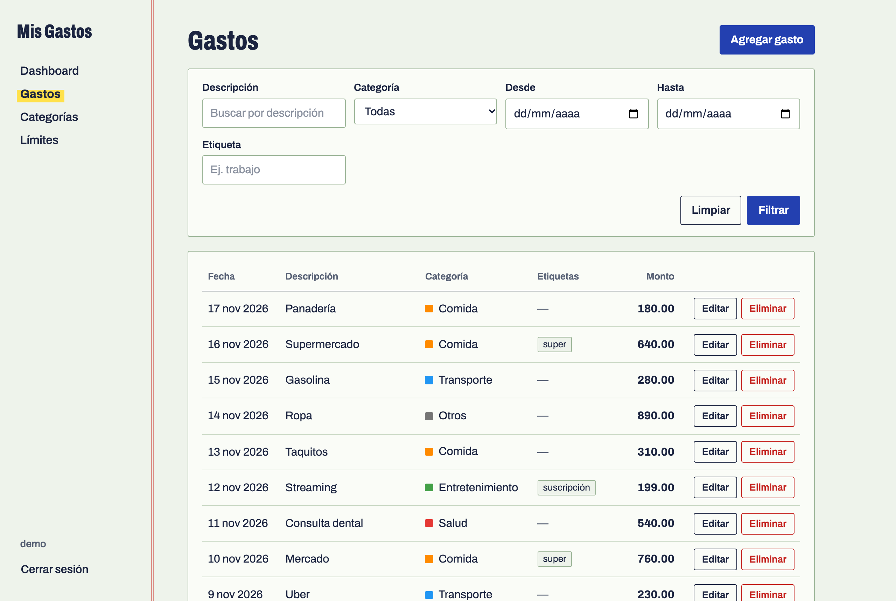
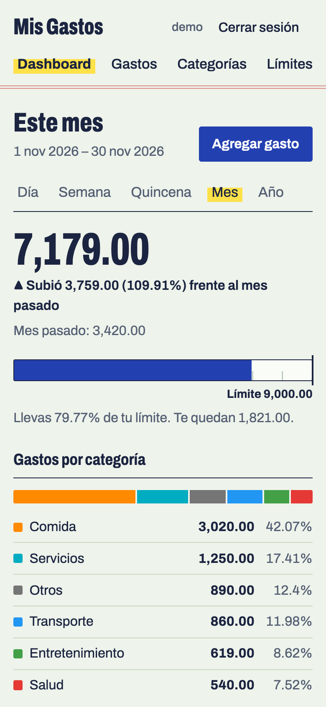

<div align="center">

# 📒 Mis Gastos

**Tu libreta de cuentas personal: anota lo que gastas, mira a dónde se va tu dinero y ponle límite antes de pasarte.**

[](https://github.com/maycuca/01_gastosApp/releases/tag/v1.0.0)
[](https://openjdk.org/)
[](https://spring.io/projects/spring-boot)
[](https://react.dev/)
[](https://vite.dev/)
[](https://sqlite.org/)

[](#-calidad)
[](#-calidad)
[](#-privacidad-y-seguridad)

<br>



</div>

---

## ✨ Qué puedes hacer

| | |
|---|---|
| 🧾 **Registrar gastos** | Monto, descripción, fecha, categoría y etiquetas libres (`super`, `casa`, `trabajo`…). Edita o elimina cuando quieras. |
| 📊 **Ver tu dashboard** | Pestañas por **día, semana, quincena, mes y año**, con el total, gastos por categoría y gasto por día. |
| 📈 **Compararte** | Cada período se compara con el anterior completo: “Subió 20 % frente al mes pasado”. |
| 🚦 **Fijar límites** | Un tope por período. La regla te dice cuánto llevas y cuánto te queda; si te pasas, todo se pinta de rojo. Avisa, nunca bloquea. |
| 🏷️ **Organizar a tu manera** | 7 categorías iniciales con color, más las que quieras crear o renombrar. |
| 🔎 **Encontrar cualquier gasto** | Filtros por descripción, categoría, etiqueta y rango de fechas, con paginación. |
| 📱 **Usarla en el celular** | Diseño adaptable hasta 390 px de ancho. |

## 🖼️ Capturas

<table>
  <tr>
    <td width="50%"></td>
    <td width="50%"></td>
  </tr>
  <tr>
    <td align="center"><b>La semana, frente a la anterior</b></td>
    <td align="center"><b>Agrega un gasto sin salir del dashboard</b></td>
  </tr>
  <tr>
    <td></td>
    <td align="center"></td>
  </tr>
  <tr>
    <td align="center"><b>Todos tus gastos, con filtros</b></td>
    <td align="center"><b>También en el celular</b></td>
  </tr>
</table>

> El diseño imita una **libreta de cuentas**: papel verde pálido, tinta azul, el margen rojo de los cuadernos, resaltador amarillo para lo que está activo y rojo solo cuando te pasas del límite.

## 🚀 Empezar

**Requisitos:** Java 25 y Node.js 22 o superior.

```bash
git clone https://github.com/maycuca/01_gastosApp.git
cd 01_gastosApp/gastosAppBackend
./start.sh
```

La primera vez, `start.sh` compila el backend y la interfaz por ti, y después arranca todo en un solo proceso.

Abre **http://localhost:8080**, crea tu cuenta y empieza a anotar. 🎉

<details>
<summary><b>Modo desarrollo (recarga en caliente)</b></summary>

```bash
# Terminal 1: backend en :8080
cd gastosAppBackend && ./start.sh

# Terminal 2: frontend en :5173 con proxy de /api
cd gastosAppFronend && npm run dev
```
</details>

<details>
<summary><b>¿Olvidaste tu contraseña?</b></summary>

Desde la terminal del equipo donde corre la app:

```bash
cd gastosAppBackend && ./reset-password.sh <usuario>
```

Te da una contraseña temporal; entra con ella y cámbiala en **Cuenta**. Las sesiones anteriores de ese usuario dejan de valer.
</details>

<details>
<summary><b>Variables de entorno</b></summary>

| Variable | Por defecto | Para qué sirve |
|---|---|---|
| `GASTOS_DATA_DIR` | `../data` | Carpeta de la base de datos, la clave de sesiones y los respaldos |
| `GASTOS_FRONTEND_DIR` | `../gastosAppFronend/dist` | Interfaz compilada que sirve el backend |
| `GASTOS_BIND_ADDRESS` | `127.0.0.1` | Dirección en la que escucha el servidor |
| `GASTOS_ALLOWED_HOSTS` | — | Nombres de host adicionales permitidos |
| `JWT_SECRET` | se genera solo | Clave para firmar las sesiones |

Las rutas relativas se resuelven desde la carpeta `gastosAppBackend`, no desde donde ejecutes el comando.
</details>

## 🔒 Privacidad y seguridad

- **Tus datos no salen de tu equipo.** Todo vive en una base SQLite local (`data/gastos.db`) que nunca se sube al repositorio.
- **Respaldo diario automático** con `VACUUM INTO`; se guardan los últimos 14.
- **Solo escucha en `127.0.0.1`** y valida la cabecera `Host`.
- Contraseñas con **BCrypt**; sesiones con **JWT** que se invalidan al cambiar la contraseña.
- **Límite de intentos:** 5 fallos de login o de contraseña actual bloquean 15 minutos.
- Cabeceras de seguridad: CSP estricta, `nosniff`, `no-referrer` y `X-Frame-Options: DENY`.
- Carpeta de datos `700`; clave de sesiones y respaldos `600`.

## 🧱 Arquitectura

```
01_gastosApp/
├── gastosAppBackend/   API REST · Java 25 · Spring Boot 4 · Spring Security · SQLite
├── gastosAppFronend/   SPA · React 19 · TypeScript · Vite 8 · React Router · Recharts
├── docs/specs/         Especificación funcional: la fuente de verdad
└── data/               Base de datos local (no se versiona)
```

En uso normal el backend sirve también la interfaz compilada, así que todo corre en **un solo proceso y un solo puerto**.

Los montos se guardan en **centavos** como enteros, para que `0.10 + 0.20` siempre dé `0.30`.

## ✅ Calidad

| Módulo | Comando | Resultado |
|---|---|---|
| Backend | `JAVA_HOME=$(/usr/libexec/java_home -v 25) ./mvnw test` | 453 pruebas ✓ |
| Frontend | `npm test` | 338 pruebas ✓ |
| Frontend | `npm run lint` · `npm run build` | sin avisos ✓ |

Además, la v1.0.0 pasó una revisión de punta a punta con 166 comprobaciones contra la especificación.

## 🛠️ Cómo se construyó

El proyecto sigue **desarrollo guiado por especificaciones (SDD)**. Primero se escribe el contrato en [`docs/specs/gastos-funcional.md`](docs/specs/gastos-funcional.md): modelo de datos, endpoints y criterios de aceptación. Después lo implementan agentes de [Claude Code](https://claude.com/claude-code) especializados (`backend-dev`, `frontend-dev` y `qa-tester`, en [`.claude/agents/`](.claude/agents)), coordinados según [`CLAUDE.md`](CLAUDE.md).

## 🗺️ Lo que viene

Las ideas para próximas versiones están en la [sección 10 de la especificación](docs/specs/gastos-funcional.md#10-pendientes-para-versiones-futuras). La primera es recuperar la contraseña desde la propia app con un código de un solo uso.

---

<div align="center">
<sub>Hecho con ☕ y tinta azul por <a href="https://github.com/maycuca">@maycuca</a></sub>
</div>
